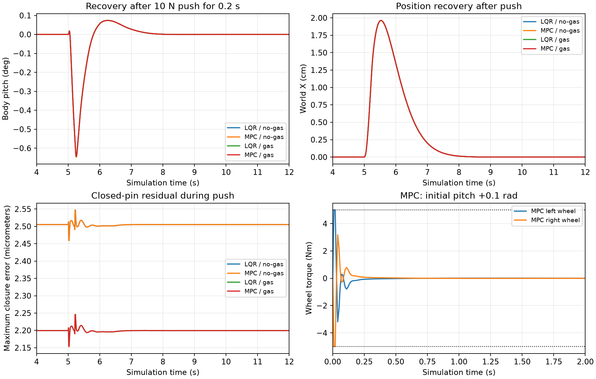

# M02 完整并联机器人站立控制与验收报告

日期：2026-11-09，Asia/Shanghai。任务：[T003](../04_tasks/T003_parallel_standing.md)。状态：**通过指定范围的 CPU 自由基座站立仿真验收**。共 18 个指定案例各积分 30 s；不是统计成功率、实机或学习策略成绩。默认采用 LQR；MPC 的离线闭环通过，但输入约束激活时未满足 10 ms 实时截止时间。

## 1. 目标与模型边界

用户要求参考其 [Leg_simulator_mujoco](https://github.com/Cofallen/Leg_simulator_mujoco)，使用项目 assets 中的 parallel（用户称 parrell）模型实现站立、检验并写报告。本轮使用 `assets/robots/infantry_parallel/` 两份正式 XML，原文件、网格、质量惯量、转轴、14 个 hinge 和 4 个 connect 全部保留。没有使用旧六关节串联替代，没有固定基座、去重力、增加支撑或向八个被动轴施加 actuator 力矩。

- 机器人源：`yly-true/fudan_rl_wheel_leg`，commit `8204e853dfd2ed06d85a322e1a998c3d20a3be2c`，模型派生方法见 [M01](M01_parallel_linkage.md)。总质量 21.054625 kg，轮半径 0.06 m，nq=21、nv=20、nu=6、neq=4。
- 用户原控制仓库：main `b0f14e8ee9331d572738885691389742028cb796`；另读取 `lqr+mpc` 固定 commit `f8039cde95b8c2a9150c6016621ea928c9215c36` 的 `mympc.py/lqr_controller.py`；`mpc` 分支 commit `faaa4e2f5e08bfd6c3ff0d7e09933f17b44e85eb` 的树/版本也已核查。原 checkout 保持 main，不修改上游。
- main 的原实现是六状态 LQR、腿长 PID 与 VMC；lqr+mpc 分支包含预测控制和叠加输出。本项目只借鉴状态反馈、支撑平衡、滚动优化思想，独立实现完整 MJCF 接触平衡、LQR 与约束 MPC。没有沿用旧 10 kg、0.05 m 轮径、0.215/0.258 m 杆长或旧 A/B/K，没有复制源控制代码到生产模块；不宣称原六状态 VMC 控制器复现。
- 源阅读、版本与早期原型：[阅读证据](../../runs/m02_standing/source_and_probes_20261109_135708_139243/metadata.json)。许可证为 unknown，见 [THIRD_PARTY](../../THIRD_PARTY.md) 与 [sources.json](../../references/sources.json)；未引入新论文引用。

## 2. 实现、控制接口与关键参数

实现位于 [standing.py](../../src/wheel_leg/control/standing.py)，入口 [run_standing.py](../../scripts/m02_standing/run_standing.py)。无依赖安装、环境升级、训练或 GPU/Isaac 操作。解释器为 `/home/cofallen/miniconda3/envs/mjlab/bin/python`，MuJoCo 3.11.0、NumPy 2.5.4、SciPy 1.18.1（确切版本以 metadata 为准）。物理周期 0.001 s，原 implicitfast/Newton 配置保持；控制周期 0.01 s。

先优化装配，再求重力和轮地接触下的静态平衡。无弹簧版基座 Z=0.249238296 m，静态最大广义加速度 4.90e-6（线速度坐标单位 m/s²，角坐标单位 rad/s²），四处最大闭链误差 2.51 µm；等效弹簧版 Z=0.249238985 m，最大广义加速度 4.27e-6、最大闭链误差 2.20 µm。两者均有四个轮地接触点。四个点不是四只轮，而是两只圆柱轮的多点接触。

真实输出按 XML 顺序映射，不假设左右电机相邻。所有 gear=1，ctrl 单位为 N·m：

| actuator | joint | qpos 地址 | qvel 地址 | 限幅 N·m | 无弹簧静态 N·m | 等效弹簧静态 N·m |
|---|---|---:|---:|---:|---:|---:|
| act_lf0 | lf0_Joint | 10 | 9 | ±30 | +10.40447 | +9.08842 |
| act_lw | l_wheel_Joint | 12 | 11 | ±5 | +0.000593 | +0.000593 |
| act_rf0 | rf0_Joint | 7 | 6 | ±30 | -10.32771 | -9.01158 |
| act_rw | r_wheel_Joint | 9 | 8 | ±5 | -0.000562 | -0.000562 |
| act_lf20 | l20_Joint | 17 | 16 | ±30 | -10.75648 | -9.44042 |
| act_rf20 | r20_Joint | 13 | 12 | ±30 | +10.64802 | +9.33189 |

这些是仿真输入范围，不是硬件额定参数。等效弹簧降低静态驱动力矩，只说明当前未标定 tendon 模型的作用，不是真机弹簧辨识结论。

状态由 `mj_differentiatePos(q_ref,q)` 的 20 维切空间误差和 20 维速度构成，去掉横向绝对位置与左右轮绝对相位三个位置项，保留其速度，得到 37 维反馈。基座四元数存储为 wxyz；长度 m、角度 rad、线速度 m/s、角速度 rad/s。37 维保留闭链树形冗余坐标，不等于 37 个独立自由度。控制用到基座和被动关节真值，属于**仿真特权状态**，没有宣称可由现有实机传感器直接取得。原始 21 维 qpos/20 维 qvel 均记录，记录时间来自积分时间而非墙钟。

LQR 在原始 `mj_step` 上用居中有限差分得到 A1/B1，再按 10 步零阶保持提升得到 A/B。反馈 `u=u_ref-Ke`，输入按 XML 限幅。位置 Q 权重：X=1000、Z=3000、roll=2000、pitch=4000、yaw=100，非轮关节=100；速度权重：基座 `[10,0,30,10,20,10]`、非轮关节=1、轮速度=0.01；R=0.1I。两个模型分别重新求平衡点和增益，Q/R 不变。局部闭环谱半径约 0.98270 / 0.98258；这不能代替非线性验收。

MPC 采用同一局部模型，N=15、视界 0.15 s，阶段代价 Q/R、末端代价 LQR 的 P，对全部预测步的六个电机力矩施加边界。可行的无约束解直接采用；边界激活时用 L-BFGS-B 解凸二次型，滚动执行首步。求解失败有显式限幅 LQR 回退及失败计数，该次验收会失败。本轮正式案例失败计数均为 0。没有沿用旧控制仓库的 LQR/MPC 混合比例。

初始化才优化/写入 qpos。积分过程中控制只写六个 ctrl；推力案例额外写机身外力。没有通过轨迹播放或每步重置状态制造站立。

## 3. 运行前定义的验收与案例

先 10 s nominal 冒烟，再 30 s 正式评测。判据在 [任务卡](../04_tasks/T003_parallel_standing.md) 与每次运行 metadata 中保存：完成规定时长；最后 5 s 的 |roll|/|pitch| 峰值 <0.05 rad；全程平面位置漂移 <0.1 m；闭环残差 <1e-4 m；输入不超 XML 限幅；数值有限、无警告、被动轴 actuator 力矩为零。额外检查没有非轮几何接地。提前终止条件为 Z<0.12 m、|roll|/|pitch|>0.6 rad、非有限值或数值警告；`timeout=true` 表示完成评测时长，`terminated=true` 表示提前结束，两者不混用。

案例：nominal；初始 pitch +0.03 / -0.03 rad；初始 roll +0.03 rad；t=[5,5.2) s 向机身质心施加世界 +X 方向 10 N（冲量约 2 N·s）。+0.03 rad 已用于早期开发，属于回归；其余为预登记的后续检查。MPC 另加 +0.1 rad 前倾，检验真实积分中约束分支。没有根据这些结果进行 Q/R 再调参，也没有随机种子统计。带弹簧 MPC 仅检验 nominal/push，未扩展声称其全部初始倾角范围通过。

## 4. 实际结果

下表 max drift 是全程最大平面漂移，final tilt 是最后 5 s 的 roll/pitch 峰值。原始值比表中舍入值更精确，nominal 的微小漂移没有被改成数学意义的零。

| Control | Model | Case | Seconds | Max drift (cm) | Final tilt peak (rad) | Max pin error (µm) | Pass |
|---|---|---|---:|---:|---:|---:|---|
| LQR | no-gas | nominal | 30 | 0.0000 | 1.48e-06 | 2.505 | yes |
| LQR | no-gas | pitch-plus | 30 | 0.4961 | 3.8e-07 | 2.785 | yes |
| LQR | no-gas | pitch-minus | 30 | 0.4742 | 2.72e-06 | 3.572 | yes |
| LQR | no-gas | push | 30 | 1.9627 | 1.56e-06 | 2.547 | yes |
| LQR | no-gas | roll | 30 | 0.9782 | 2.25e-06 | 4.166 | yes |
| MPC | no-gas | nominal | 30 | 0.0000 | 1.48e-06 | 2.505 | yes |
| MPC | no-gas | pitch-plus | 30 | 0.4961 | 3.8e-07 | 2.785 | yes |
| MPC | no-gas | pitch-minus | 30 | 0.4742 | 2.72e-06 | 3.572 | yes |
| MPC | no-gas | push | 30 | 1.9627 | 1.56e-06 | 2.547 | yes |
| MPC | no-gas | roll | 30 | 0.9782 | 2.25e-06 | 4.166 | yes |
| MPC | no-gas | pitch-large | 30 | 1.8351 | 1.67e-06 | 3.390 | yes |
| LQR | gas | nominal | 30 | 0.0000 | 1.29e-06 | 2.199 | yes |
| LQR | gas | pitch-plus | 30 | 0.4961 | 1.91e-07 | 2.473 | yes |
| LQR | gas | pitch-minus | 30 | 0.4740 | 2.52e-06 | 3.259 | yes |
| LQR | gas | push | 30 | 1.9614 | 1.36e-06 | 2.246 | yes |
| LQR | gas | roll | 30 | 0.9812 | 2.06e-06 | 3.757 | yes |
| MPC | gas | nominal | 30 | 0.0000 | 1.29e-06 | 2.199 | yes |
| MPC | gas | push | 30 | 1.9614 | 1.36e-06 | 2.246 | yes |

全部 18 个案例均达到 30 s，terminated=false、timeout=true，无数值警告、无非轮接地，被动轴直接 actuator 力矩均为 0。最大闭链误差约 4.17 µm，低于 100 µm 阈值。推力测试最大漂移约 1.96 cm；侧倾案例允许约 7.64 mm 最终横向偏移，因为没有反馈绝对横向位置，不能据此称为全平面位置伺服。

MPC 的 +0.1 rad 案例实际激活约束求解 2 次、失败 0 次，轮力矩达到 ±5 N·m，最大腿力矩约 17.45 N·m，最大漂移约 1.84 cm。普通小扰动下约束未激活，LQR 与带 LQR 末端代价的 MPC 轨迹重合符合理论，不能用这些重合结果宣称 MPC 更强。



[聚合原始指标](../../runs/m02_standing/report_20261109_140332_146596/summary.json)。四组正式证据：

- [lqr_no-gas_20261109_135714_434732](../../runs/m02_standing/lqr_no-gas_20261109_135714_434732/results.json)：同目录保存 metadata、配置/源码快照、日志、设计矩阵、每个案例 trace 和退出码。
- [mpc_no-gas_20261109_135947_125217](../../runs/m02_standing/mpc_no-gas_20261109_135947_125217/results.json)：同目录保存 metadata、配置/源码快照、日志、设计矩阵、每个案例 trace 和退出码。
- [lqr_gas_20261109_140138_434688](../../runs/m02_standing/lqr_gas_20261109_140138_434688/results.json)：同目录保存 metadata、配置/源码快照、日志、设计矩阵、每个案例 trace 和退出码。
- [mpc_gas_20261109_140245_737252](../../runs/m02_standing/mpc_gas_20261109_140245_737252/results.json)：同目录保存 metadata、配置/源码快照、日志、设计矩阵、每个案例 trace 和退出码。

数学检查：[design_check](../../runs/m02_standing/design_check_20261109_135930_484209/results.json)；37 个小误差方向上 MPC/LQR 首步差最大约 3.25e-19 N·m。0.1 rad 误差的约束解全序列越界=0，投影梯度无穷范数 1.23e-6（阈值 1e-4），22 次迭代，无求解失败。两份正式 XML 的 SHA256 与 M01 manifest 一致，未修改模型。

**计算时延边界**：无弹簧 LQR 正式案例的控制函数最大调用约 0.34 ms；MPC +0.1 rad 案例最慢约 41.29 ms，超过 10 ms 控制周期。只记录单次控制函数墙钟，不包括完整部署链路；离线积分会等待控制结果，没有注入这 41 ms 的执行延迟。因此 MPC 的实时部署条件未通过，本报告只认定其离线闭环/输入约束测试通过。

实际仿真录像另做 10 s 推力案例：[push.mp4](../../runs/m02_standing/lqr_no-gas_20261109_140329_963534/push.mp4)、[最后一帧](../../runs/m02_standing/lqr_no-gas_20261109_140329_963534/push_final.png)、[该次结果](../../runs/m02_standing/lqr_no-gas_20261109_140329_963534/results.json)。已检查首/尾画面和 ffprobe：H.264、640×480、10 fps、101 帧（含 t=0/10 两端，封装时长 10.1 s）；是实际逐步积分的完整机构画面，未用生成图片或状态回放代替。物理重力/自由基座/四处闭环均保持，原生 GUI 未在本轮打开。

## 5. 失败记录与证据完整性

早期相对差分静态优化落到无接触自由落体，最大基座 Z 加速度约 -9.78 m/s²；原型进程退出 0 但平衡不通过。快照与明确失败判定保存在 source_and_probes 目录。改为三点居中绝对差分后求得有效支撑点。

正式入口第一次给静态优化加 box bounds 时，又漂到基座约 0.871 m、接触数 0，达到迭代上限；[失败日志](../../runs/m02_standing/lqr_no-gas_20261109_135634_476468/run.log)，退出 2。当前采用无界求静态力平衡后严格拒绝越界解、max qacc>0.001 或接触不足的解，动态输出仍严格限幅；未放宽站立验收。

各运行新建独立目录，不覆写历史。每次保留解释器、依赖版本、命令、模型/网格/执行代码哈希、源码快照、原始日志、退出状态、平衡点与反馈矩阵、100 Hz 状态/力矩。`*_trace.npz` 的 ctrl 是该记录状态时刻之前一积分段持有的输入；下一步控制在该记录之后计算。首次 t=0 记录时尚未执行首步，ctrl 为初始零。原型与失败不计入 18 个正式案例，也不删除。没有 checkpoint、训练成绩或假视频。

## 6. 使用与复验

从项目根目录运行，所有命令使用已有 mjlab 解释器：

```bash
# 最小站立与完整默认 LQR 验收
PYTHONNOUSERSITE=1 /home/cofallen/miniconda3/envs/mjlab/bin/python -B scripts/m02_standing/run_standing.py --duration 10 --cases nominal
PYTHONNOUSERSITE=1 /home/cofallen/miniconda3/envs/mjlab/bin/python -B scripts/m02_standing/run_standing.py --controller lqr --duration 30
# MPC：原五个案例加真实约束激活检查
PYTHONNOUSERSITE=1 /home/cofallen/miniconda3/envs/mjlab/bin/python -B scripts/m02_standing/run_standing.py --controller mpc --duration 30 --cases nominal,pitch-plus,pitch-minus,push,roll,pitch-large
# 两个气弹簧控制分支的本轮范围
PYTHONNOUSERSITE=1 /home/cofallen/miniconda3/envs/mjlab/bin/python -B scripts/m02_standing/run_standing.py --controller lqr --variant gas --duration 30
PYTHONNOUSERSITE=1 /home/cofallen/miniconda3/envs/mjlab/bin/python -B scripts/m02_standing/run_standing.py --controller mpc --variant gas --duration 30 --cases nominal,push
# 数学性质与模型完整性，不重新积分
PYTHONNOUSERSITE=1 /home/cofallen/miniconda3/envs/mjlab/bin/python -B scripts/m02_standing/check_design.py --design-run runs/m02_standing/lqr_no-gas_20261109_135714_434732
# 桌面显示（本轮原生 GUI 未验证，需用户桌面运行）；可替换为 --video 保存离屏录像
PYTHONNOUSERSITE=1 /home/cofallen/miniconda3/envs/mjlab/bin/python -B scripts/m02_standing/run_standing.py --controller lqr --duration 30 --cases push --viewer
```

`--variant gas` 是未标定 k=1000 N/m、c=10 N·s/m、自由长度 0.2 m 的等效 tendon，不能当作真实气弹簧热力学/行程验证。模型视觉保持既有 STL，未借“弹簧”名义变形或删减连杆。

交付静态检查：[results.json](../../runs/m02_standing/delivery_check_20261109_140716_441221/results.json)。6 个 Python 文件通过语法检查、163 个本地 Markdown 链接有效、来源 JSON 可解析、上游 checkout clean，正式 XML 哈希未变。首尾录像画面与曲线已目视检查。

## 7. 未确认项与下一项最小任务

本轮只覆盖平地、固定模型、近站立姿态 reset。没有实现倒地起身、行走指令、复杂地形、参数泛化或训练策略。原生 GUI、GPU/Isaac、实物传感器、执行器额定值、通信时延与部署观测均未验证。当前控制依赖仿真真值；不能直接据这些 K 接实机。

下一项最小任务：以这个 LQR 为教师，先核对 IMU/四个主动腿轴/轮编码器的坐标与采样时序，构造可部署状态估计，并与特权状态在同一短站立轨迹上逐项对照；再决定数据采集或短训练。若继续 MPC，先验证固定预算求解与延迟注入，再讨论实时运行。详细原理和关键代码见[学习笔记](../03_learning/M02_01_完整闭链站立与LQR_MPC.md)。

## 后续追加：按结构规范整理独立副本

用户随后要求小项目集中、可复制。在 [E001](../../experiments/E001_parallel_standing/README.md) 新建独立副本，保留本报告所述旧代码/模型/运行目录；不改历史成绩和 metadata。控制算法逐字节相同，入口改本地资源/导入/输出，默认改为 10 s 最小案例。本轮异地五个 10 s 案例与本报告对应轨迹前缀一致；原生 C 文件访问未做系统级完整追踪。复制结论、失败、依赖和未验证项见 [独立报告](../../experiments/E001_parallel_standing/REPORT.md)，不将 18 个旧案例冒充独立副本重跑。
