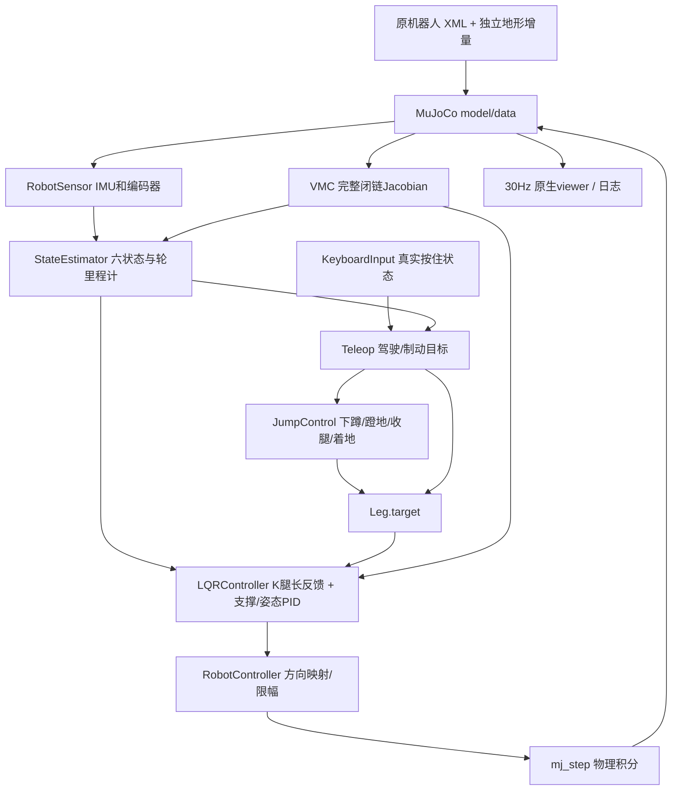

# 程序思路与架构

## 数据如何流动



## 每步顺序与周期

```python
mj_forward(model, data)               # 更新当前姿态/约束几何
imu = read_state()                     # 传感器→VMC→六状态
pressed, actions = keyboard.poll()     # 每10个物理步取一次缓存
teleop.set_pressed(pressed)            # 必须传空集合，才能松开停止
teleop.observe(model, data, dt)        # 接触/COM/实际腿长
teleop.update(imu, dt)                 # 各输入轴→目标；跳跃阶段/落地淡入
left = lqr.control_left(leg_L, imu)     # K仅每10ms更新；支撑内环每步
right = lqr.control_right(leg_R, imu)
write_actuators(left, right)           # 仅原六个电机，XML力矩限幅
mj_step(model, data)                   # 真实积分，未锁基座/未改被动轴
```

物理与支撑1kHz，六状态反馈100Hz，后台X11约100Hz加服务器响应，viewer约30Hz。显示/录像只观察，不参与控制。

## 模块职责与阅读顺序

| 顺序 | 文件 | 改什么 |
|---|---|---|
| 1 | parameters.py | 所有常用参数、PID初始化和目标 |
| 2 | teleop.py | 按住输入、速度/转向斜坡、制动、位置保持 |
| 3 | jump.py | 独立跳跃阶段、接触记录、腿长目标限速 |
| 4 | lqr_controller.py | 六状态误差、K(L)、支撑与姿态反馈、制动模式 |
| 5 | lqr.py | 线性化→CARE→逐项三次拟合→运行求值 |
| 6 | lqr_model.py | 高级完整闭链平面投影，普通调参不改 |
| 7 | vmc.py | 随机身朝向的虚功映射，不能固定世界X/Z |
| 8 | get_state.py | 六状态估计、轮架补偿、轮里程计边界 |
| 9 | controller.py | 初始化/组装/1ms循环/显示/日志/跌倒策略 |
| 10 | scenes/*.xml + render_stand.py | 独立地形/运行场景合成，原机器人XML不变 |

## 控制量和边界

六状态是 `[theta,dtheta,s,dot_s,phi,dphi]`，K输出虚拟轮力矩和摆腿力矩；支撑是重量标定项+腿长P−长度阻尼+横滚差动+蹬地附加力。VMC把虚拟支撑/摆腿力矩变为四个腿电机力矩，另两个轮电机负责平衡和差动转向。完整机构仍14转动关节、4个闭环连接、6个驱动，并非六关节简化模型。

跳跃中保留移动请求，但空转轮速不当机身速度；着地后满足稳定接触/长度恢复，再把速度反馈从0渐增到1。否则着地轮速尖峰容易触发错误平衡动作。低高度不再单独关闭电机，倾角确实倒地才暂停平衡输出；倒地仍积分，数值异常仍退出。

制动并不改变基础拟合K文件：制动模式可放大速度误差，等效反馈增益发生变化，必须独立做稳定性测试，不能称它也是重新求得的最优K。偏航用角速度闭环、目标限速和差动力矩上限。当前位置只在速度足够低后保持，避免把平衡车突然锁位置导致翻倒。

[逐项参数](PARAMETERS.md)与[报告](REPORT.md)给出实测、失败及未验工况。
