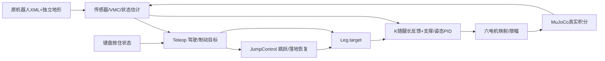

# 轮腿机器人：键盘控制

代码集中在 `LQR_six/`，最外层 `controller.py` 启动。沿用作者六状态LQR/PID/VMC接口，使用完整闭链模型；不是学习策略或实物控制。

## 启动

在本目录运行；使用已有mjlab解释器，不自动安装依赖：

```bash
PYTHONNOUSERSITE=1 /home/cofallen/miniconda3/envs/mjlab/bin/python -B controller.py
```

关闭旧进程后重启才会加载新代码。点击窗口聚焦，把鼠标放在中央三维区驾驶；移入侧面板或失焦停止驾驶。默认原生左右面板、FREE自由相机，左键旋转、右键平移、滚轮缩放；走出画面可移动相机或启动加 `--camera-follow`。

## 程序思路与架构

先读[逐项参数手册](PARAMETERS.md)与[架构/周期/接口详解](ARCHITECTURE.md)。参数手册列出每个参数的当前值、单位、作用和调整影响。



主循环顺序：更新物理几何→读IMU/关节→闭链VMC与六状态→键盘目标/跳跃→K反馈和腿长/姿态PID→六电机限幅→物理积分→显示/记录。物理和支撑1kHz、K反馈100Hz、显示约30Hz。完整闭链仍保留全部连杆/14转动关节/4闭合连接，6个电机不等于6关节模型。

落地的“坐地”有两处处理：不再因基座高度低就关闭支撑；稳定接触、竖直速度小且实际腿长恢复后，才逐渐重新使用轮速反馈。腿长P/D恢复2000/0，避免20000/100000在限幅下冲击；髋关节电机在 E002 的软件输出与 MuJoCo 运行时均限幅 ±40 N·m，轮电机为 ±5 N·m。

当前前进目标为 1.2 m/s，后退为 0.85 m/s。后退目标加速 1.0 m/s²、制动 1.25 m/s²，后退制动的速度误差系数为 1.35，拟合 K 保留原文件。

## 独立台阶与17°斜坡

默认仍为原平地。新地形只在 `scenes/training_terrain.xml`，运行时合并，不修改原机器人XML：

```bash
PYTHONNOUSERSITE=1 /home/cofallen/miniconda3/envs/mjlab/bin/python -B controller.py --terrain training --camera terrain
```

| 位置/名称 | 几何 |
|---|---|
| 10cm组，y=0，x约−2/−2.8m | 两级，每级10cm，顶面0.10/0.20m |
| 20cm组，y=+2m，x约−2/−2.8m | 两级，每级20cm，顶面0.20/0.40m |
| 斜坡，y=−2m，中心x=−3m | 17°，斜面长2m、宽1.4m、厚0.1m |

台阶踏面长.8m、宽1.4m；机器人从原点平地开始。`--camera terrain`只是自由相机初始总览，仍可鼠标调视角。坡角文件用弧度.29670597，因为原模型compiler为radian，不能直接写17。

地形使用本项目独立编写的MuJoCo刚性box，未下载外部模型，因此没有新增外部许可依赖。完成尺寸/坡角、原资产哈希和场景起始平地10s站立检查；**没有声明已自主爬上台阶或17°坡面**。这是手动驾驶/跳跃的测试场景，平地LQR不自动变成地形规划控制器。

## 键盘与叠加

| 键位 | 当前行为 |
|---|---|
| W / S | 按住前进/后退，前进目标 1.2 m/s，后退 0.85 m/s；松开制动 |
| A / D | 按住左/右转，目标±2rad/s；转向加速和松开缓停都有斜坡 |
| Shift | **按住**持续小陀螺，目标4rad/s，松开缓停；初始左转，A/D选择并记住方向 |
| Shift + A / D | 选择小陀螺方向；松开A/D、仍按Shift会继续朝该方向转 |
| J | 单次跳跃，允许按住W/S时触发；重复按不会打断正在进行的跳跃 |
| Q / E | 按住连续缩腿/伸腿，松开保持当前目标 |
| X | 停车；连续键先全部松开，再按可重新驾驶 |
| R | 重置速度/转向/腿长目标，不瞬移、不自动扶正 |

W/S、A/D、Shift、Q/E是独立轴，J是独立动作，可以叠加，不再要求“方向键松开且停稳才能J”。验证了前进+J、Shift+A/D及松开缓停；未声称任意速度/高度/跳跃/转向组合都稳定。

W对应模型−X，S对应+X。真实物理速度不是松开后瞬间清零。Shift为按住模式，不是单击锁存；转向加速默认0.6rad/s²、制动2rad/s²，角速度目标按斜坡变化。

跳跃时保留W/S请求和惯性前进，空中暂不使用轮里程计速度误差追速度，着地后按稳定接触与腿长恢复渐入：空中轮子转动不等于机身速度，收腿时强行追这个误差容易翻转。动作结束后恢复正常速度反馈。

## 参数统一在一个文件

**编辑 `LQR_six/parameters.py`，不需要到控制函数里面搜数值。**

| 参数组 | 内容 | 单位/注意事项 |
|---|---|---|
| `DRIVE` | 前后速度、加减速、A/D速度、Shift速度/方向、转向斜坡、停稳阈值、腿长范围/变化率 | m/s、m/s²、rad/s、rad/s²、m |
| `JUMP` | 下蹲/蹬地/收腿目标、支撑力、阶段时间、空中维持、腿长变化限速、预落地条件 | m、N/侧、s、m/s |
| `PID` | 左右腿长、roll、双腿同步、yaw角速度及历史Leg接口的所有PID初始化 | 元组 `(kp,ki,kd,初始目标)` |
| `CONTROL` | LQR周期、参考腿长、各阻尼、偏航力矩限幅、腿/轮限幅、MPC配置、g | 最终仍受XML限幅 |
| `TARGET` | theta/dtheta/s/dot_s/phi/dphi/l0/roll/yaw/yaw_rate/d2theta/jump_force初值 | m、rad及其导数 |
| `REFERENCE` | 是否用实测reset姿态、theta/phi偏置 | 默认用站立标定姿态，覆盖对应初始目标 |
| `MONITOR` | 低机身/倾角记录线、倒地时是否关闭平衡电机输出 | **跌倒不终止** |
| `LQR_FIT` | Q/R、拟合范围/中心/尺度/阶数 | 离线参数；改后需另行生成系数，不自动重拟合 |
| `LINEARIZATION` | 当前系数标定时的支撑内环、差分精度、投影/伪逆阈值 | 与运行PID分列，不能冒称改PID就已重标定K |

常用修改示例（均在parameters.py内）：

```python
DRIVE['spin_rate'] = 2.0          # Shift转速目标，rad/s
DRIVE['yaw_brake'] = .6          # 松开后的角速度目标变化率
JUMP['tuck_hold_time'] = .24      # 从实际离地开始维持收腿目标，秒
PID['length_left'] = (2000., 0., 0., .278)
TARGET['roll'] = 0.              # 站立roll目标，rad
```

PID沿用作者的**离散D项** `kd*(e-e_last)`，不是 `kd*de/dt`；腿长D允许使用实测长度变化，避免目标阶跃产生D冲击。公共roll/delta/yaw PID每个物理步只更新一次，左右复用。当前所有启用PID的ki=0；原PID没有把积分加入返回值，单独改ki不会启用积分。`legacy_*`只是保留接口，主控制不用它们。

当前采用长度P=2000、D=0、同步P=50、D=0；较大的旧D/同步增益和400N强跳尝试造成失稳，快照与失败保留。运行质量取XML，不能把质量当普通增益随意改：机身16.877574kg、单侧8.438787kg，左右腿（除轮）1.597924/1.598327kg，各轮.4904kg，总21.054625kg。

普通腿长输入保留你当前的.16–.36m设置；**K仍只在.18–.34m拟合并截断使用端点**，范围之外没有精度/稳定性验收。当前安全跳跃目标为下蹲.20、蹬地.34、收腿.18m，腿/轮限幅仍30/5Nm。

## 跳跃怎么读

`jump.py / JumpControl`只按阶段返回 `(腿长目标,附加支撑力)`：

```text
下蹲 → 蹬地 → 实际离地：收腿并维持0.24s → 展腿 → 接触恢复
```

收腿目标从原约.128s提高到实测约.241s。目标变化有2m/s限速；低空下落时可提前展腿，不保证为了计时强行缩腿撞地。腾空后额外支撑归零，不给基座向上外力，不写qpos/qvel。`observe()`只读接触/高度并记录，`request()`发起动作，`update()`选择阶段和限速输出。

收腿提高轮底间隙，不能保证整机质心更高；机身参考点、整机COM和轮底通过高度在报告中分别记录。

## K矩阵怎么读

`lqr.py`现在只保留清晰流程，复杂闭链动力学放在 `lqr_model.py`：

```text
get_k:   linearize(工作点) → solve_lqr(A,B) → K
fit_ABK: 多腿长逐点求A/B/K → 归一化腿长 → 每个矩阵元素分别polyfit
get_K:   按实测腿长读取已保存的三次式
```

```python
from LQR_six.lqr import GainSchedule
K, used_length = GainSchedule('no-gas').get_K(.24)
# 系数在gain_schedule.json；控制时查看lqr.K_left / K_right / gain_length。
```

公式和系数顺序明确写成：

```text
L = clip(实测腿长, .18, .34)      # m
x = (L-.26)/.08
K = C3*x³ + C2*x² + C1*x + C0   # 每个C为2×6，JSON顺序[C3,C2,C1,C0]
u = -K @ (state-target)
```

左右腿各按自己的L在100Hz更新，1ms物理循环不解CARE。本轮**没有改gain_schedule.json数值**；拆分前后A/B/K和拟合结果审计一致。原0.33m处最大2.35%留出拟合误差仍保留，不宣称2%精度检查已通过。MPC仍用nominal A/B，不是时变MPC。

离线重算时使用新输出路径，不能覆写历史：

```bash
PYTHONNOUSERSITE=1 /home/cofallen/miniconda3/envs/mjlab/bin/python -B LQR_six/lqr.py \
  --variant no-gas \
  --points outputs/length_gain_20261109_231153_464420/static_points.json \
  --output outputs/refit_new.json
```

## 翻倒与界面

运行期间持续检测倒地。窗口 HUD 显示自起阶段和左右腿角，数值异常会结束本次仿真。姿态和力矩的详细规则见本页的倒地自起部分。

可选启动项：`--no-drive`关闭驾驶键用于原生面板检查；`--camera-follow`跟随；`--no-ui`隐藏面板；`--hud`开启低频文字；`--viewer --duration 24`有限窗口短测；`--headless --duration 10`无头回归。passive viewer由Python积分，面板Pause/Reset不是完整standalone simulate工作流。Shift在三维区占用为驾驶键，原生检查用--no-drive。

## 本轮验证与来源

- A/D左右各20s：持续按11s、松开后站稳，均不翻；累计转角约±7.67rad。
- Shift左右各20s：实际峰值约±1.526rad/s、累计约±16.37rad（约2.6圈），松开后实际角速度<.0003rad/s。
- 前进+J和静止J各12s通过；前进+J总机身X位移约−7.28m（含起跳前后行走），收腿阶段约.241s。
- 主入口倾斜后仍完整运行10s，数值警告为0，站立验收如实判失败；真实窗口额外约259N外力推倒后仍运行到24s。
- 新名称缓存前后10s轨迹逐值相同；最新交互窗口RTF约.999，首次受控窗口.879未过实时目标，失败保留。
- 必要文件复制到新/tmp目录、从/tmp启动10s通过，模块/输出只在副本，不写回原工程。

[本轮summary](outputs/stacked_controls_20261110_115613_339792/summary.json)、[完整报告与失败](REPORT.md)、[来源清单](SOURCE_MANIFEST.json)。真实窗口第二轮的自动枚举脚本遇到BadWindow，之后有额外手动输入/外力；不能把该轮当独占自动按键时序。所有新输出位于自身outputs新目录。

未验证任意键位组合、极限腿长/速度、gas混合驾驶/跳跃、长期、原生Wayland/Windows、跨机、实物或训练。原始模型、网格、闭链、质量与环境未改，依赖现有MuJoCo/NumPy/SciPy和Linux/X11。原作者文件改编、本项目数值标定/新增逻辑的归属见THIRD_PARTY、SOURCE_MANIFEST和SOURCE_CHANGES。

当前制动/落地/地形复验见[summary](outputs/terrain_braking_20261110_131430/summary.json)，历史较慢制动数值保留在报告中，不当作当前响应。

<a id="10-cm-单级台阶短测"></a>
## 多地形场景和自动上台阶

在 E002 目录使用已有 mjlab 解释器运行：

```bash
PYTHONNOUSERSITE=1 /home/cofallen/miniconda3/envs/mjlab/bin/python -B controller.py --step-up
```

默认打开 MuJoCo，加载多地形场景，可持续键盘驾驶。场景沿 −X 前进，中央每级 10 cm，Y=+2 m 每级 20 cm，Y=−2 m 是 17° 斜坡。地形可直接编辑。[场景 XML](scenes/step_up_course.xml)

要看自动跳上首级 10 cm 并停稳，运行 `python -B controller.py --auto-step-up`。加 `--headless` 可无窗口短测，加 `--video` 可录像。原独立单级场景可通过 `--terrain step10` 加载。

## 倒地自起

默认运行监测倒地和起身。用左右各自的重力参考腿角、IMU 姿态和触地情况判定倒地，腿角阈值为 `±0.8π rad`。自起入口要求机身趴地、两腿后摆、两腿长度均 ≥ 0.265 m。用髋关节力矩先收腿、再将机身带到双轮支撑的小倾角区间。起身动作期间轮力矩为零。进入 LQR 后逐步开放轮力矩，过渡阶段每轮限 3 N·m，站稳后恢复正常驾驶。

其他倒姿默认保持零输出。加 `--recovery-prepare` 可试验伸长两腿，再转到机身后方。准备期间轮力矩为零，四髋各限 15 N·m。自起试验 `--recovery-trial` 默认开启准备动作，可加 `--recovery-roll` 设置横滚。两种入口都须通过后摆长腿和机身接触检查，才会开始收腿。失败后重新检测倒姿。

`theta_body` 为机身坐标下每条腿的独立角度，髋轴到轮心朝机身正下方为 0，后摆为负。运行的 `trace.npz` 同时保存左右 `theta_body` 和重力参考角，便于对照。

在 E002 目录用现有 mjlab Python 运行。下面的演示在 reset 设置倾角，随后靠物理和执行器起身。

```bash
python -B controller.py --viewer --recovery-trial=1.45 --camera side --camera-follow
python -B controller.py --viewer --recovery-trial=2.0 --camera side --camera-follow
```

测试覆盖无气弹簧模型的指定后摆倒姿和准备流程。试验接受有限角度，结果取决于落地姿态和接管。[实测与参数](REPORT.md#2026-11-13-后摆长腿收腿与-lqr-接管)

状态 2 直入 LQR 对照试验：

```bash
python -B controller.py --headless --duration 10 --recovery-trial=2.0 --recovery-direct-lqr
```

可加 `--viewer --camera side --camera-follow` 替换 `--headless` 观察。直入分支跳过收腿与摆髋，实验结果见 [报告](REPORT.md#状态-2-直入-lqr-对照)。
