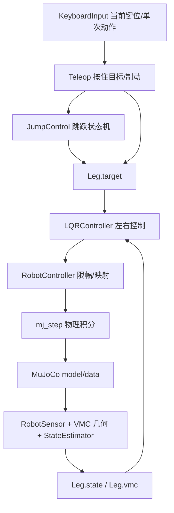

# 键盘控制轮腿机器人

关闭旧仿真窗口后，从本目录运行：

```bash
PYTHONNOUSERSITE=1 /home/cofallen/miniconda3/envs/mjlab/bin/python -B controller.py
```

点击窗口获得焦点，**把鼠标放在中央三维区驾驶**；移入左右面板会停止驾驶并恢复原生按键。**W/S、A/D、Q/E 都改成按住生效；松开后不再锁存。** 关闭窗口结束；失去窗口焦点同样清空按住键。现有进程不会热更新，改代码后要重启。

| 按键 | 按住时 | 松开时 |
|---|---|---|
| W / S | 机器人前进 / 后退，目标速度 ±1.2 m/s | 目标归零、制动，停稳后位置保持 |
| A / D | 左 / 右转，目标 0.2 rad/s | 停止转向命令，保留阻尼 |
| Q / E | 连续缩腿 / 伸腿，0.12 m/s，范围 0.18–0.34 m | 保持松开时的腿长目标 |
| J | 停稳后按一次，执行下蹲→蹬地→腾空收腿→展腿→落地 | 不重复触发 |
| X | 停车；持续键需先松开再按才重新启动 | — |
| R | 恢复默认速度/转向/腿长目标，不瞬移模型 | — |

W 的方向已按本模型外观的前方修正：初始姿态中对应 **模型 −X**，S 对应 +X。只改驾驶目标方向，不翻转已经配套的 IMU、轮编码器或电机力矩轴。

速度上限由 0.4 提至 **1.2 m/s（3 倍）**，目标加速度也由 0.5 提至 1.5 m/s²。松开立即进入制动，不会继续保持原速度；真实物理速度需要减速，不能瞬间清零。短测中从约 1.18 m/s 降至 0.05 m/s 以下约需 1.5 s。所有速度/时长均按**仿真时间**，当前按墙钟节拍运行，目标 1 秒仿真对应 1 秒现实；退出后的 results.json 中 timing.real_time_factor 可核对。避免同时开多个旧仿真窗口。

## 实时播放与普通 MuJoCo 视角

默认显示原生左右面板、使用 **FREE 自由相机**。左键旋转、右键平移、滚轮缩放；初始只设一个能看清机器人的机位，之后不重置鼠标视角。自由相机不会追随行走，走出画面可平移观察或启动时加 `--camera-follow`。

| 启动选项 | 作用 |
|---|---|
| 无参数 | 持续驾驶，原生面板、自由视角，文字关闭 |
| `--no-drive` | 仅站立观察，所有原生显示快捷键交给 MuJoCo |
| `--hud` | 可选状态文字，按墙钟最多10Hz更新 |
| `--no-ui` | 隐藏左右面板 |
| `--camera-follow` | 可选跟随机身 |
| `--viewer --duration 14` | 有限窗口短测，结束后自动保存并退出 |

显示约30Hz，物理步长仍1ms；启动全量 sync 一次，循环用 `sync(state_only=True)`。计算快时 sleep 等待墙钟；负载超过预算时如实记录落后，不跳过物理步或加大 dt。这里恢复的是 passive viewer 的原生界面/视角，Python 仍掌管积分和控制；面板的 Pause/Run、重置/改模型不等同完整 standalone simulate 工作流，日常关闭窗口后重启重置。

本机真实按键行走/松开/J：14s仿真 / 14.1063s墙钟，RTF=0.99247。最终含鼠标旋转、移入面板停止与可选HUD的复验：14s / 14.00197s，RTF=0.99986；单帧不是硬实时保证，短时最大落后约0.164s。详见 [REPORT.md](REPORT.md) 的失败对照与证据。1倍播放速度和机器人目标速度1.2m/s是不同参数，本轮未再增大电机或驾驶目标。

## 随腿长拟合的 K（当前实现）

`LQR_six/lqr.py` 负责完整闭链模型的离线线性化、CARE和三次拟合；`lqr_controller.py` 在100Hz反馈时按**左右各自实测髋轴到轮心长度**选K，不在1kHz循环实时解CARE。系数保存在本目录 `gain_schedule.json`，不是再用原来的一个固定K。

```text
L = clip(实测腿长, 0.18, 0.34)     单位 m
x = (L - 0.26) / 0.08
K(L) = C3*x³ + C2*x² + C1*x + C0  每个C都是2×6矩阵
u = -K(L) @ (state - target)
```

`variants[no-gas/gas].K_coeffs` 按 `[C3,C2,C1,C0]` 排列，12个元素各自拟合。采样0.18至0.34m、间隔0.02m，Q=diag(3000,1,500,1,30000,1)、R=I₂；A/B也离线拟合并保存。`GainSchedule.get_K(L)` 返回 `(K, 实际使用的截断长度)`；`evaluate(L)` 返回 `(A,B,K,L)`。超出范围使用端点，不能外推为新腿长已验收。

```python
from LQR_six.lqr import GainSchedule
K, used_L = GainSchedule('no-gas').get_K(.24)
# 控制器运行时可检查 lqr.K_left、lqr.K_right、lqr.gain_length
```

质量直接来自本项目XML，不沿用旧lqr.py中0.05m轮径/.572kg轮子或等效杆质量：

| 质量项 | kg | 用法 |
|---|---:|---|
| 全机身 | 16.877574 | XML真实机身，不再重复给左右各算一整机身 |
| 单边机身 | 8.438787 | 机身质量的一半 |
| 左腿 / 右腿（各6个独立连杆，除轮） | 1.597924 / 1.598327 | 全部求和，不遗漏闭链后支路 |
| 每个轮子 | 0.490400 | 单独计入动力学，轮径0.06m |
| 整机 | 21.054625 | 与上述项总和一致 |

腿长变化改变几何、质心位置和等效惯量，**不会改变连杆真实质量**。离线动力学使用完整模型全部质量/惯量、双侧对称虚拟输入求导；K的两个输出仍是单轮力矩和单侧摆腿力矩，不把整机质量再重复分配。支撑基项改为 `(机身/2 + 该侧腿质量)*g + force_trim`；trim由原静态reset力矩标定，零位支撑仍等于标定值，轮子质量不重复加到髋轴支撑里。

再拟合（读取既有工作点，输出必须为新文件）：

```bash
PYTHONNOUSERSITE=1 /home/cofallen/miniconda3/envs/mjlab/bin/python -B LQR_six/lqr.py \
  --variant no-gas \
  --points outputs/length_gain_20261109_231153_464420/static_points.json \
  --output outputs/refit_new.json
```

重新采工作点的方法保存在同轮 `static_points.py`，须先另建新运行目录，不覆写旧数据。gas工作点独立用gas模型求解，当前系数按variant与XML哈希校验，不混用。可选MPC仍采用nominal A/B预测模型，本轮只实现K(L)，没有宣称实现时变MPC或其硬实时保证。

当前无弹簧采样拟合整体误差约0.136%；8个中点留出最大2.35%（0.33m），**未达到初设2%精度检查**，但全部留出闭环特征值稳定，边界/若干留出长度非线性站立、连续变长、前后行走与跳跃通过。0.33m附近精度限制、失败和原始矩阵见REPORT，不隐藏此项。

## 独立跳跃模块与腾空收腿

跳跃状态机现在集中在 `LQR_six/jump.py / JumpControl`；Teleop只负责J请求与把输出接到Leg.target。流程为：下蹲→蹬地→**实际离地后收腿**→提前展腿→接触恢复。以无接触连续6ms且向上速度>0.05m/s确认腾空，不以计时器假定已经离地；记录基座高度、整机质心、轮底间隙和各阶段时间。

| 参数 / 位置 | 默认值 | 含义 |
|---|---:|---|
| `Teleop.jump_tuck` → `JumpControl.tuck_length` | .18m | 腾空收腿目标，实际长度受动力学/限幅影响 |
| `JumpControl.tuck_min_time` | .10s | 最短收腿阶段 |
| `JumpControl.tuck_max_time` | .22s | 最长收腿阶段，之后强制预落地展腿 |
| `JumpControl.extend_com_vz` | .45m/s | 最短阶段后，COM向上速度降至此值开始展腿 |
| `Teleop.jump_tuck_enabled` | True | False可做同条件不收腿对照 |

`JumpControl.request()` 请求；`observe(model,data,dt)`读接触/质心；`update(now,home_length)`返回 `(腿长目标,额外支撑力)`；`active/phase/history`供主循环和日志查看。腾空后额外支撑归零，仅电机内部收腿；接触后恢复站立，不修改qpos/qvel或给基座向上外力。

同K、同蹬地、只切换收腿的10s对照：轮底最大间隙 **.16263→.24215m（增加约7.95cm）**，两者落地稳定。COM最高点 **.53660→.53669m**，几乎相同；基座最高点 **.46933→.46638m**。因此改善的是轮底通过高度，不能保证机身/整机质心更高。源轮碰撞中心减0.06m定义轮底间隙，COM用全部body_mass加权，二者不能混淆。

本轮默认真实窗口14模拟秒/14.00084墙钟秒，RTF=.99994；记录到额外按键，不能把自动脚本当作独占输入时序。首次HUD窗口RTF=.87325未过实时目标，已保留；当前短测非硬实时保证。详见[报告](REPORT.md)、[汇总](outputs/length_gain_20261109_231153_464420/summary.json)与[增益/跳跃图](outputs/length_gain_20261109_231153_464420/gain_and_jump.png)。

## 交互参数：Teleop 与 JumpControl

驾驶参数与兼容跳跃入口在 `LQR_six/teleop.py → Teleop.__init__`，跳跃阶段参数在 `LQR_six/jump.py → JumpControl.__init__`。启动文件实例化时也可用命名参数覆盖，例如：

```python
teleop = Teleop(leg_L, leg_R, yaw_kp=lqr.pid_yaw.kp,
                speed_max=1.2, forward_sign=-1.,
                l0_min=.18, l0_max=.34, l0_rate=.12,
                jump_crouch=.20, jump_extend=.34, jump_force=200.)
```

| 参数 | 当前值 | 单位 / 含义 |
|---|---:|---|
| `speed_max` | 1.2 | m/s，W/S 目标速度幅值 |
| `forward_sign` | -1 | W 到模型纵向速度的符号；模型版本换方向时改这里 |
| `accel` | 1.5 | m/s²，目标速度上升斜率 |
| `brake_accel` | 3.0 | m/s²，松开/换向时目标速度斜率，不等于实际机身瞬时减速度 |
| `yaw_rate_max` | 0.2 | rad/s，A/D 转向目标 |
| `yaw_kp` | 5.0 | 使用 LQRController 的 yaw P 增益，供速率目标换算 |
| `l0_min`, `l0_max` | 0.18, 0.34 | m，腿长目标边界（原 0.22–0.30） |
| `l0_rate` | 0.12 | m/s，Q/E 按住期间的目标变化率 |
| `jump_crouch` | 0.20 | m，起跳前下蹲目标（原 0.24） |
| `jump_extend` | 0.34 | m，蹬地目标（原 0.30） |
| `jump_force` | 200 | N，每侧额外 VMC 支撑目标（原 140） |
| `jump_crouch_time` | 0.40 | s，下蹲阶段时长 |
| `jump_thrust_time` | 0.20 | s，蹬地阶段时长（原 0.15） |
| `jump_total_time` | 1.60 | s，动作结束/恢复时间，相对起跳动作开始 |

`l0_home` 从静态 reset 标定读取，约 0.27792 m。跳跃仍经六个真实电机和 VMC 输出；腿 ±30 N·m、轮 ±5 N·m 没有提高。没有向基座施加向上外力、改 qpos/qvel 或解开闭链。参数增大后应复验，尤其不要把“增大 jump_force”理解为力矩可无上限增大。

## 函数接口

| 文件 / 类 | 接口 | 输入与输出 |
|---|---|---|
| `keyboardInput.py / KeyboardInput` | `set_viewport(viewer.viewport)` | 更新原生三维区边界；侧面板内不驾驶 |
| 同上 | `poll() → (pressed, actions)` | 非阻塞读取后台真实键位和 J/X/R 按下边沿；失焦/鼠标离开三维区返回空集合 |
| 同上 | `close()` | 停止查询线程、释放本窗口驾驶键抓取、关闭 X11 连接 |
| `teleop.py / Teleop` | `set_pressed(keys)` | 输入当前键集合；空集合表示松开，不是锁存命令 |
| 同上 | `on_key('j'/'x'/'r')` | 单次动作；J 要求方向键已松开且速度接近零 |
| 同上 | `update(imu, dt)` | 每物理步生成 `Leg.target` 的 `s/dot_s/l0/yaw/jump_force`；dt 单位 s |
| 同上 | `observe(model, data, dt)` | 只记录实际高度、向上速度和无接触时长，不写物理状态 |
| 同上 | `status()` | 当前按住键、速度/腿长、动作阶段和事件/跳跃记录 |
| `lqr_controller.py / LQRController` | `control_left/right(leg, imu)` | 六状态反馈 + 支撑/姿态修正 + VMC，返回腿电机力矩与轮力矩 |
| `write_sensor.py / RobotController` | `set_actuator(name, torque)` | 命名映射和 XML 力矩限幅，写入 `data.ctrl` |

主循环中两类输入分开处理，按键查询每 10 个物理步一次（约 100 Hz），目标与 VMC/支撑控制每 1 ms 更新：

```python
keyboard.set_viewport(viewer.viewport)
pressed, actions = keyboard.poll()
teleop.set_pressed(pressed)       # 即使为空集合也必须传入，才能处理释放
for action in actions:
    teleop.on_key(action)         # J/X/R 只触发一次
teleop.observe(model, data, dt)   # 记录，不改物理
teleop.update(imu, dt)            # 连续腿长/速度目标和动作阶段
```

MuJoCo passive viewer 的 `key_callback` 没有释放事件，所以不能再拿它累加 W/S 或腿长。本实现用系统已有 **libX11 的当前键位查询**，只在 `_NET_WM_PID` 匹配本进程的 MuJoCo 窗口聚焦且鼠标位于三维区时生效，不用自动重复按键猜测释放，不监听/记录其它应用文本。X11 查询放在后台线程，物理循环只取缓存，避免显示服务器等待拖慢积分。查询间隔约10ms加X11响应时间；J/X/R 应正常点按（建议至少50ms），极短点按不保证捕获。驾驶键仅在本窗口三维区启用局部被动抓取，避免 W/J/X 同时切换线框、关节或纹理；不定期覆写显示 flags。无需安装 pynput。此输入后端目前仅验证本机 Linux/X11，未验证原生 Wayland/Windows。

## 代码架构与修改建议



- 最外层 `controller.py` 只负责组装、循环和窗口，其余 Python 继续放 `LQR_six/`；不为调参重排工程。
- **驾驶参数改Teleop；跳跃状态和阶段参数改JumpControl；键位/焦点/释放改KeyboardInput。** 不把键盘处理塞进 LQR 或直接写电机。
- **增益采样/拟合改lqr.py，系数在gain_schedule.json；运行反馈/支撑修正改LQRController；完整机构Jacobian改VMC。** 模型质量、惯量、轮径、几何变动需重新标定/验证 K，不通过翻转输入方向掩盖模型错误。
- 轮子 mesh、棋盘和显示设置放 `render_stand.py`；日志/验收放 `simulation.py`。显示不参与控制，测试脚本不代替真实按键验证。

## 本轮实测与输出

- 无头实际控制循环，W/S 分别到约 −1.18/+1.18 m/s，松开后制动停车；各 12 s 未倒。
- 腿长目标从 0.18 连续扫到 0.34 m，松开后保持；实际腿长及边界误差见 [REPORT.md](REPORT.md)。这是静止时分项测试，不是所有高度与最高速度组合都已验证。
- 增强跳跃：机身从约 0.24924 m 到 0.47061 m，上升约 **22.1 cm**（前版约 12.7 cm），双轮腾空约 **0.42 s** 后稳定落地。
- 本机真实 GLFW/XTest **按下和释放**已验证，日志含 `w → released → s → released`、Q/E 按下/释放和 J；不是只模拟 `on_key`。完整范围、失败和证据见 [REPORT.md](REPORT.md)。

每次输出在自身 `outputs/<新运行ID>/`，包含命令/解释器/版本、源码快照、真实键状态事件、目标/状态/力矩 trace、实际轮角/接触/机身位置 `motion.npz`、结果与退出码。数值检查可用 `--headless --duration 10`；其它旧录像/相机参数保留兼容，不是日常操作必需。

源轮 STL/正式 XML/闭链/地面碰撞与摩擦保持原样，棋盘只属运行显示。依赖已有 Python/MuJoCo/NumPy/SciPy 和 GUI 的系统 libX11，版本见 requirements.txt；不自动安装或修改环境。原作者来源/差异见 SOURCE_MANIFEST.json、SOURCE_CHANGES.patch、THIRD_PARTY.md。

当前仍是平地仿真：空中自由轮速积分不等于机身位移；没有跨机、实物、硬实时、长期反复跳跃、任意组合或学习训练验收。

本轮新增gain_schedule.json后已再次做独立复制10s验证：从原工程外启动，副本模块/资源/输出独立，原工程outputs未写回；证据见[copy_check](outputs/length_gain_20261109_231153_464420/copy_check.json)。
